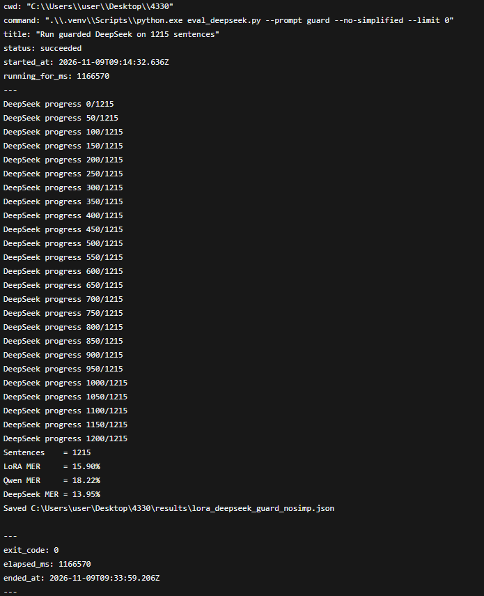
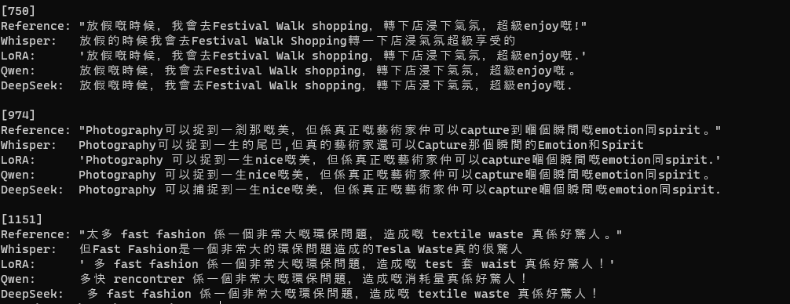
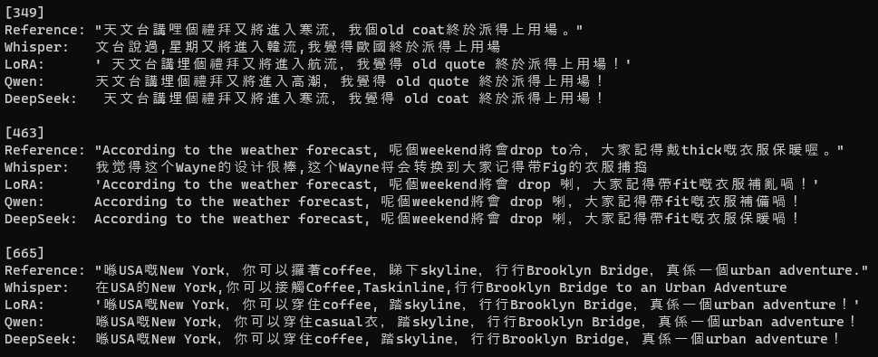
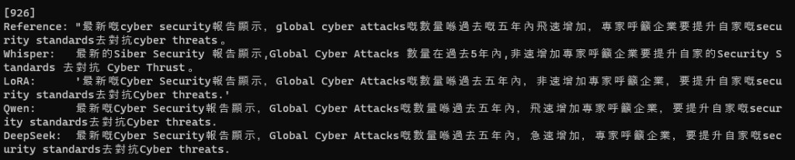
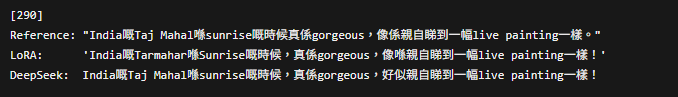

# Cantonese-English Whisper with LoRA

COMP 4330SEF experiment. The base model is the original multilingual `openai/whisper-small`. It is frozen, and only a LoRA adapter is trained on the Mixed Cantonese and English (MCE) dataset. Decoding uses `language=zh` and `task=transcribe`, because this Whisper-small checkpoint has no `yue` language token.

## Result

The Hugging Face copy of MCE has 14,051 utterances and no official test split. This project holds out 10% with seed 42 (1,405 test utterances, 12,646 training utterances). MER counts each Chinese character and each English word as one token. A higher MER is worse.

| Setup | MER | Trainable parameters | Peak GPU memory | Training time |
| --- | --- | --- | --- | --- |
| Original Whisper-small | 45.72% | 0 | inference only | 0 |
| LoRA on `q_proj` and `v_proj` | 17.61% | about 0.73% of the model | 3.85 GB | 16.8 min |
| Same LoRA plus a fixed topic prompt | 17.62% | same adapter | same | same |

The reported system is the first LoRA adapter plus this fixed prompt: `天氣 霧 颱風 能見度 食物 交通 購物 學習 電影`. The prompt does not contain reference transcripts. It fixes some sound-alike errors, such as hearing 霧 as `mode`, without changing the overall MER in a meaningful way.

Xie and Chen fully fine-tuned Whisper-small and reported about 14.3% MER on their own test split. They did not use LoRA. The 17.62% figure here is not comparable to 14.3%, because the test utterances are different.

A second training epoch raised MER to 19.11%. A wider LoRA adapter raised it to 18.80%. Those runs are kept as negative results and are not the submitted model.

## Optional text post-processing

Qwen2.5-7B-Instruct and DeepSeek were tested only as text post-processors. They rewrite the LoRA transcript. They do not hear the audio, and their own weights are not trained.

On all 1,405 test sentences, Qwen raised MER from 17.62% to 19.82%. That run is a negative result.

A second comparison uses a smaller test set. At least 190 of the 1,405 reference transcripts mix in simplified characters. MER counts 马 and 馬 as different characters, so those 190 sentences are removed from this score. The remaining 1,215 sentences are not a new training run. On that subset:

| Setup | MER |
| --- | --- |
| Original Whisper-small | 43.48% |
| LoRA plus the fixed topic prompt | 15.90% |
| LoRA drafts rewritten by Qwen | 18.22% |
| LoRA drafts rewritten by DeepSeek | 13.95% |

DeepSeek uses `deepseek-flash` with thinking disabled and `temperature=0`. The 13.95% figure belongs to these 1,215 sentences. It does not replace the 17.62% result on the full test set.



`show_random5.py` reprints five sentences from this subset. Whisper is transcribed again. LoRA, Qwen, and DeepSeek are the saved outputs.

```powershell
python show_random5.py --seed 42
```









## Layout

- `eval_baseline.py` scores the original model.
- `train_lora.py` trains the submitted adapter into `outputs/lora`.
- `eval_lora.py` scores an adapter. Pass `--prompt` for the topic prompt.
- `demo.py` writes `demo_clips/1.wav` through `5.wav` and `demo_clips/transcripts.txt`.
- `score_no_simplified.py` rescores the saved LoRA drafts after dropping references that contain simplified characters. `--baseline` rescores the original Whisper model on the same sentences.
- `eval_deepseek.py` rewrites saved LoRA drafts with DeepSeek. `--prompt guard --no-simplified` is the 1,215-sentence run.
- `show_random5.py` prints five random sentences from that run.
- `data/split.json` stores the train and test indices.
- `docs/figures/` stores the screenshots above.

The audio parquet files are not in this repository. Download them into `data/mce` from [AlienKevin/mixed_cantonese_and_english_speech](https://huggingface.co/datasets/AlienKevin/mixed_cantonese_and_english_speech). The MCE dataset is for research use.

## Run

Install a CUDA build of PyTorch first, then:

```powershell
py -3.11 -m venv .venv
.\.venv\Scripts\Activate.ps1
pip install torch --index-url https://download.pytorch.org/whl/cu132
pip install -r requirements.txt
python eval_baseline.py
python train_lora.py
python eval_lora.py --prompt "天氣 霧 颱風 能見度 食物 交通 購物 學習 電影" --output lora_prompt.json
python demo.py
python show_random5.py --seed 42
```

`eval_baseline.py` creates `data/split.json` if it is missing. Training was run on an NVIDIA GeForce RTX 4070.
